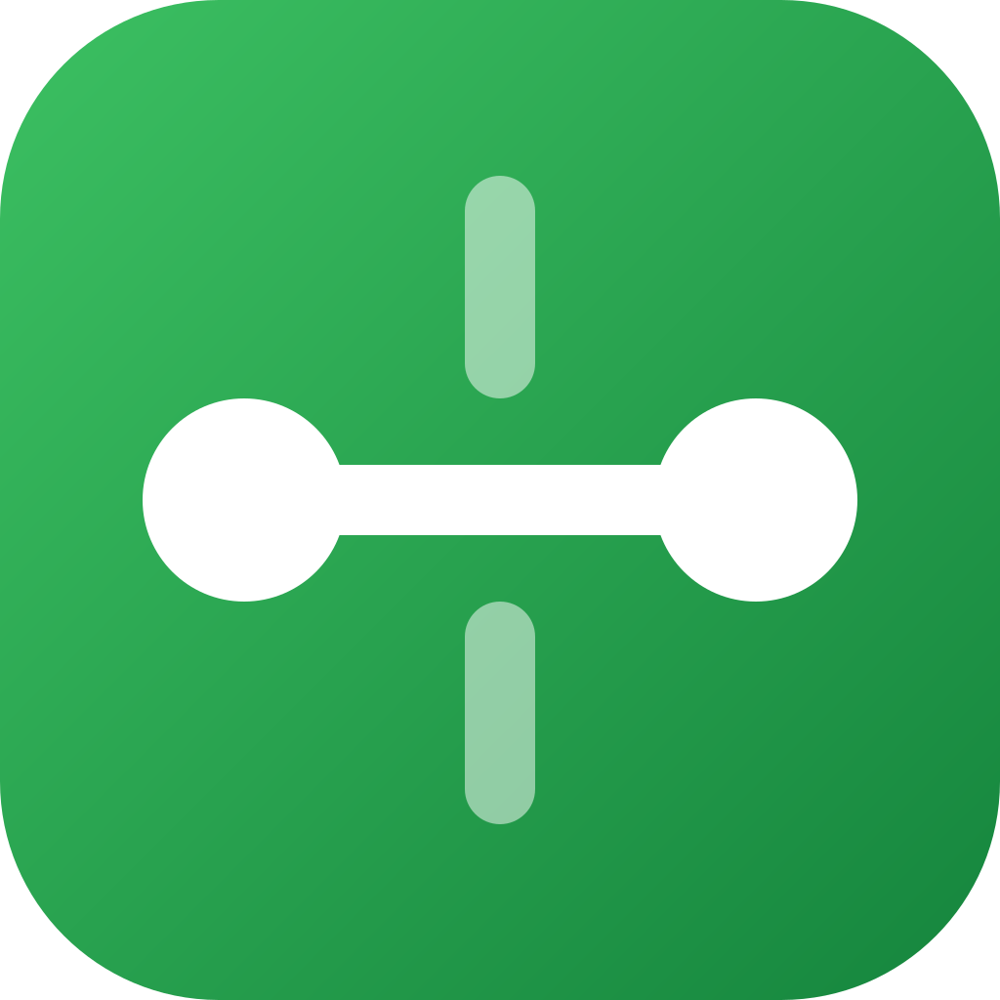
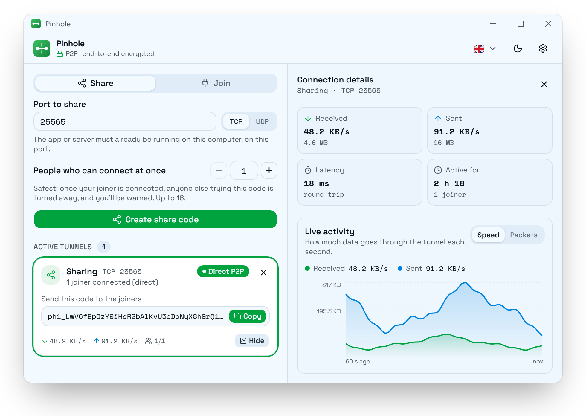
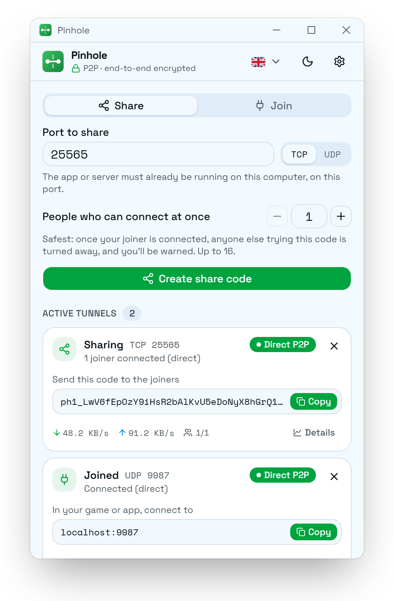

<p align="center"></p>

<h1 align="center">Pinhole</h1>

Share any TCP or UDP port with someone else, peer-to-peer and end-to-end encrypted, without opening a port on your router.

*A pinhole is the tiny opening that hole punching makes in each router's NAT: Pinhole sends your traffic straight through it, from one PC to the other.*

<p align="center">
  <picture>
    <source media="(prefers-color-scheme: dark)" srcset="docs/screenshots/details-dark.png">
    
  </picture>
</p>

Built with [iroh](https://iroh.computer) (QUIC + hole punching), [Tauri 2](https://tauri.app) and React + TypeScript (Vite), UI in [shadcn/ui](https://ui.shadcn.com) with the tweakcn "Rewaff" theme (Space Grotesk / Space Mono, light and dark).

The window stays small and fixed: a share/join form, then one card per tunnel with the share code or local address and a live speed line. *Details* widens the window (when the screen is wide enough) and opens a side panel with the speed or packet graph (last 60 s), latency, a *How you are connected* explainer (the relay introduced you, the data goes direct, and what crossed the relay), and the speed of each connected joiner. The UI is in English and French (see [Translations](#translations)).

## Usage

<picture>
  <source media="(prefers-color-scheme: dark)" srcset="docs/screenshots/list-dark.png">
  
</picture>

**Host** (a game server, a website, a database… anything listening on a port): *Share* tab → enter the port → *Create share code* → send the `ph1_…` code to the people who will join.

**Joiner**: *Join* tab → paste the code → *Connect* → in your app, connect to `localhost:<port>` (the host's port number, unless you picked another one under *Use a different local port*).

**Joiner limit**: a share accepts 1 joiner at a time by default. You can raise it up to 16 in the *Share* form; it goes back to 1 for every new share. If someone with the right code is turned away because the share is full, the host's card warns you: if you didn't expect it, your code has reached someone else, so stop the share and create a new one.

**If the connection drops** (Wi-Fi change, a PC going to sleep…), the joiner reconnects on its own and keeps trying for 5 minutes before giving up. When a connection fails, the card says why (no direct path possible, host not responding, code refused, share full…) and what to try.

**Closing the window**: Pinhole asks whether to keep running in the system tray (your tunnels stay up in the background) or to quit (every tunnel is stopped and the people connected through them are disconnected). Tick *Remember my choice* to stop asking; you can change it later in ⚙ *Settings* → *When closing the window*. While Pinhole runs, its icon sits in the system tray: click it to show the window again, right-click it and pick *Quit Pinhole* to stop every tunnel and exit. (Where the desktop has no tray, such as some Linux desktops without an indicator extension, keeping it running minimizes the window instead.)

**Your own relay** (optional): ⚙ *Settings* → *My own relay* → its address, just the server (e.g. `https://relay.example.com`, no path). It applies to new shares and joins, and is stored on this PC only. Each side picks its relay independently: the share code carries the host's relay URL, so a joiner on the default relays can still join a host using a self-hosted one. Plain `http://` is accepted for a relay on your own network, but prefer `https://`: over http, anyone on the network can see which computers use the relay (the tunnel itself stays end-to-end encrypted).

## How it works


- **The share code** holds the host's identity (public key), its home relay URL, the protocol (TCP or UDP), the port, and a 16-byte secret token. It never contains IP addresses: if no relay can be reached within 10 s, sharing fails instead. Stopping the share invalidates the code (new key and token on every share).
- **Direct only**: the relay is only used to introduce the two PCs (QUIC handshake and hole punching coordination). No data, the token included, is exchanged until a direct path is up; if hole punching fails within 20 s, the attempt stops with an error. If iroh later moves the connection to the relay, a watchdog closes it instead.
- **Token check**: once the direct path is up, the joiner sends the token; the host checks it in constant time, then takes a joiner place (or answers that the share is full). A wrong token closes the connection.
- **Reconnection**: a joiner whose connection drops starts over (a new introduction, a new direct path, the token again), after 2 s and then with growing pauses up to 30 s, for 5 minutes. It keeps its identity, so the host gives it back its own place even when the share is full. The very first connection doesn't retry: a wrong code, a full share or a network without P2P is reported at once.
- **Forwarding**: TCP: each local connection becomes a bidirectional QUIC stream. UDP: each packet becomes a QUIC datagram prefixed with a flow id (one flow per local UDP client).
- **Relay traffic**: about 50 KB per connection for the introduction, then a small keepalive every 5 s on the relay path, which iroh keeps open on standby (that is why the counter in *Details* keeps growing slowly). All of it is end-to-end encrypted. The relay sees both public keys and IP addresses, and the size and timing of the packets it forwards; it never sees the share code, the token or your data.

## Security

- Only someone holding the code can use the tunnel: the host's key pins the QUIC/TLS connection (the relay can neither read nor impersonate), and the token gates every byte forwarded to the local service.
- The code does not contain your IP addresses (only the relay URL); peers learn them during hole punching, as with any P2P connection.
- The joiner only listens on `127.0.0.1`; the host only forwards to its own loopback (`127.0.0.1`, or `::1` for TCP services that listen there only).
- **Joiner limit**: the limit counts identities, not connections: a joiner who reconnects automatically takes back their own place. Someone with the right code who arrives when the share is full is refused with a clear message, and the host's card warns that the code has reached someone else (the count is in `TunnelInfo.refused`). With the default of 1, a leaked code is useless while your joiner is connected. One false alarm is possible: a joiner whose app closed without disconnecting (crash, power cut) and who joins again within about 30 s has a new identity, so they are refused until QUIC notices the old connection is gone.
- Other abuse ceilings per share, fixed in `src-tauri/src/tunnel.rs`: 8 connections in setup, 128 concurrent TCP connections and 64 UDP flows per joiner, UDP flows forgotten after 120 s idle. These are maximums, not reservations: nothing is allocated until a joiner actually connects.
- Messages from the other side never reach the screen as text: errors are reported as fixed codes that the UI translates.
- The UI is locked down, so a bug or injected content in the web view can't reach the rest of the system:
  - its Content Security Policy only allows the app's own bundled scripts, fonts and images: no remote scripts or content, no inline scripts (release builds), no `eval`, no plugins or frames, and no network access other than the Tauri bridge to the Rust side. Inline styles are allowed, because the UI libraries set `style` attributes;
  - its Tauri capability (`src-tauri/capabilities/default.json`) only lets it call the app's own commands (the tunnel ones `share`, `join`, `stop`, `list`, plus `hide`, `quit` and `tray_labels` for closing to the tray), listen for the close request, and read or set its own window size (for the *Details* panel, which also needs the screen width). No file system, shell, process, clipboard-plugin or other OS access is granted. The network is only reached through those commands, whose inputs are validated in Rust (ports, joiner limit, share code, and a relay URL limited to scheme, host and port).

## Known limitations

- UDP datagrams are limited to ~1200 bytes (QUIC MTU); larger packets are dropped. Most games (RakNet, etc.) adapt.
- Anyone who has the code can take a free place while the share is active (with the default limit of 1: whenever your joiner isn't connected). Stop the share when you're done: that kills the code. Any program on the joiner's PC can use the local port.
- The shared service must listen on `127.0.0.1` / `0.0.0.0` (or `::1` / `::` for TCP). UDP services are only reached on `127.0.0.1`.
- Anyone who finds the host's IP and port can open QUIC connections without the code: they are refused at the token check, but can keep the 8 setup slots busy and delay legitimate joins.
- By default the introduction uses n0's public relays, which are free but meant for development and testing (rate limited). For heavier use, set your own relay in *Settings*:
  - **self-host**: run the open-source `iroh-relay` server (from the iroh repository, as a release binary or the `n0computer/iroh-relay` Docker image) on a machine with a public IP and a DNS name; it gets TLS certificates automatically. See [Add a relay](https://docs.iroh.computer/add-a-relay), [Self-hosted relays](https://docs.iroh.computer/iroh-services/relays/self-hosted) and [Relays (concepts)](https://docs.iroh.computer/concepts/relays);
  - **managed**: dedicated relays run by n0 ([Iroh Services](https://docs.iroh.computer/iroh-services/relays/managed)).
- iroh has no switch to forbid the relay for data: the policy is enforced by the app, and packets already queued in the milliseconds before the watchdog closes the connection may cross the relay (still end-to-end encrypted).
- iroh keeps the relay path open (a keepalive every 5 s) for the whole connection, so the relay keeps seeing that the two keys are connected. In iroh this path is a fallback that keeps a connection alive through network changes (Wi-Fi switch, mobile handoff) while it punches a new direct path. Pinhole doesn't use it: the watchdog closes the connection instead of falling back, a crashed peer is detected by QUIC's idle timeout, and the automatic reconnect opens a brand-new connection through the relay server, not through this path.

## Translations

The UI follows the system language (English if it isn't available) and can be switched from the header. To add a language, copy `src/locales/en.json` to `src/locales/<code>.json` (e.g. `de.json`), translate the values, and set `meta.name`, `meta.locale` and `meta.flag`: it appears in the picker automatically. Missing keys fall back to English. `{name}` placeholders are filled in at runtime, and `_one` / `_other` suffixes are plural forms. Errors from the Rust side arrive as codes, translated through the `error.*`, `failure.*` and `help.*` keys.

## Development

Prerequisites: Node.js 20.19+ or 22.12+, Rust 1.88+, and the [Tauri prerequisites](https://tauri.app/start/prerequisites/) for your OS (WebView2 on Windows, WebKitGTK on Linux, Xcode tools on macOS).

```bash
npm install
npm run tauri dev       # app with UI hot reload
npm run tauri build     # installers (.msi / .exe, .dmg, .deb / .AppImage) in src-tauri/target/release/bundle
```

The screenshots above come from a demo mode with sample tunnels (`src/demo.ts`, dev server only). To regenerate them, start `npm run dev -- --port 1431`, then run `npm run screenshots` (needs Edge or Chrome).

To simulate a network that blocks P2P, start a dev build with `PINHOLE_FORCE_RELAY=1` (debug builds only): every connection then fails with "No direct connection possible".

```bash
PINHOLE_FORCE_RELAY=1 npm run tauri dev
```

(In PowerShell: `$env:PINHOLE_FORCE_RELAY=1; npm run tauri dev`.)

Checks (from `src-tauri/`):

```bash
cargo fmt --check && cargo clippy --all-targets -- -D warnings && cargo test
```

## Layout

```
src/                     React UI
  main.tsx, App.tsx      entry point, main layout (tabs, tunnel list, details panel)
  demo.ts                sample tunnels for the screenshots (dev server only, `/?demo`)
  api.ts                 typed calls to the Rust commands, mirrors of the Rust structs
  hooks/useTunnels.ts    1 s polling + rate and history computation
  i18n.tsx               translation provider, `useI18n()` hook
  locales/               one JSON file per language (en.json is the reference)
  lib/                   formatting, status/error texts, relay setting, window sizing
  components/            TunnelCard, TunnelDetails, ConnectionPath, TrafficChart…
  components/ui/         shadcn components (generated, `npx shadcn add …`)
src-tauri/               Rust application
  src/tunnel.rs          all the networking (share, join, direct-only policy, errors)
  src/tunnel/tests.rs    unit tests + loopback share/join tests
  src/lib.rs             Tauri commands, app setup
  src/tray.rs            closing the window, tray icon and menu, quitting
  capabilities/          what the web view may call (default.json)
  tauri.conf.json        window, CSP, bundle settings
  icons/                 generated from app-icon.svg (`npx tauri icon app-icon.svg`)
docs/how-it-works.svg    the diagram above
docs/screenshots/        README screenshots, light and dark (`npm run screenshots`)
scripts/screenshots.mjs  takes them with a headless Edge or Chrome
LICENSE                  MIT
THIRD_PARTY_NOTICES.md   licenses of the bundled fonts
```

## License

[MIT](LICENSE). The bundled fonts keep their own licenses (CC-BY 4.0 for the Twemoji flags, SIL Open Font License for Space Grotesk and Space Mono): see [THIRD_PARTY_NOTICES.md](THIRD_PARTY_NOTICES.md).
